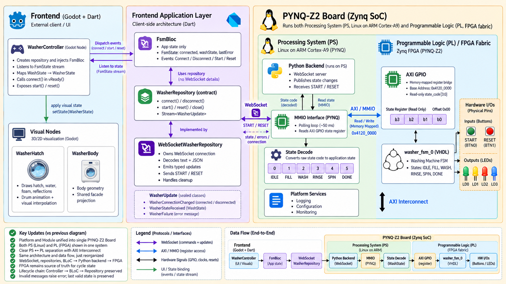

# Washing Machine FSM on PYNQ-Z2

A learning project focused on FPGA, VHDL and embedded systems concepts using the [PYNQ-Z2](https://pynq.readthedocs.io/en/latest/) board.

The goal of this project is to progressively rebuild and modernize knowledge acquired during university, especially around:

- Finite State Machines (FSM)
- FPGA development
- Hardware description languages (VHDL)
- Digital design
- Embedded systems

---

# Project Overview

This project implements a simplified washing machine controller as a Finite State Machine (FSM).

The FSM was first implemented in Python using the PYNQ framework, then re-written entirely in VHDL and synthesized directly onto the FPGA of the PYNQ-Z2 board.

The current implementation includes:

- FSM design in VHDL
- GHDL simulation
- GTKWave waveform analysis
- Vivado synthesis and implementation
- FPGA bitstream generation
- Deployment to PYNQ-Z2
- Hardware testing using physical buttons and LEDs

---

# FSM States

The washing machine simulation currently uses the following states:

```text
IDLE
FILL
WASH
RINSE
SPIN
DONE
```

---

## Current Architecture



The current system is split between the Zynq Processing System (PS), the Programmable Logic (PL), and an external Godot/Dart frontend using [godot_dart_package](https://github.com/fuzzybinary/godot_dart).

The VHDL FSM runs in the FPGA and exposes its current state through a 4-bit `state_code` signal. This signal is connected to an AXI GPIO peripheral, which makes the value available to the ARM Cortex-A9 processor through a memory-mapped register.

On the PYNQ-Z2 Linux side, a Python backend reads this `AXI GPIO` register using `PYNQ MMIO`. The backend decodes the raw state value, detects state transitions, and broadcasts the current FSM state to connected clients through a WebSocket server.

The Godot/Dart frontend connects to this WebSocket server and uses the received state updates to drive the washing machine visualization and animations.

End-to-end data flow:

```text
VHDL FSM
  -> state_code
  -> AXI GPIO
  -> MMIO read from Python
  -> WebSocket broadcast
  -> Godot/Dart visualization
```

The current state encoding is:

```text
0x0 -> IDLE
0x1 -> FILL
0x2 -> WASH
0x3 -> RINSE
0x4 -> SPIN
0x5 -> DONE
```

---
## Hardware Design (Vivado)

The hardware design was developed using **AMD Vivado 2024.1** and targets the **PYNQ-Z2 board**, based on the Zynq-7000 SoC.

The design integrates a custom VHDL finite state machine with the Zynq Processing System through an AXI-based memory-mapped interface.

### Vivado Block Design


The block design contains the following components:

| Component | Responsibility |
|---|---|
| `processing_system7_0` | Zynq Processing System running Linux |
| `ps7_0_axi_periph` | AXI interconnect between the PS and AXI peripherals |
| `rst_ps7_0_50M` | Processor system reset infrastructure |
| `axi_gpio_0` | Exposes the FSM state to the PS |
| `washer_fsm_0` | Custom VHDL washing machine finite state machine |

The FSM exposes a 4-bit `state_code[3:0]` output connected to the AXI GPIO peripheral.

The Python application running on the ARM processor reads the state through a memory-mapped register using PYNQ MMIO.

### Synthesis


The synthesized design exposes the following external signals:

- `start_0`: FSM start input.
- `fill_valve_0`: simulated water inlet valve output.
- `motor_0`: simulated motor output.
- `pump_0`: simulated drainage pump output.
- `done_led_0`: washing cycle completion indicator.

These signals represent the simplified washing machine's hardware controls and status outputs.

The FPGA bitstream is generated using Vivado and deployed to the PYNQ-Z2 for hardware execution and validation.

---

## Sample (Demo)

https://github.com/user-attachments/assets/7d36769a-2c94-49e2-b12e-3c3bfcc04427
